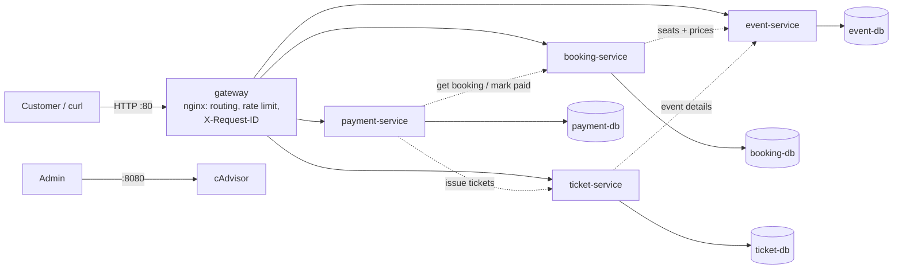
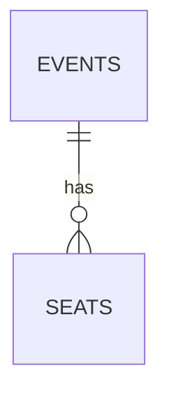
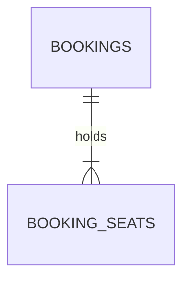
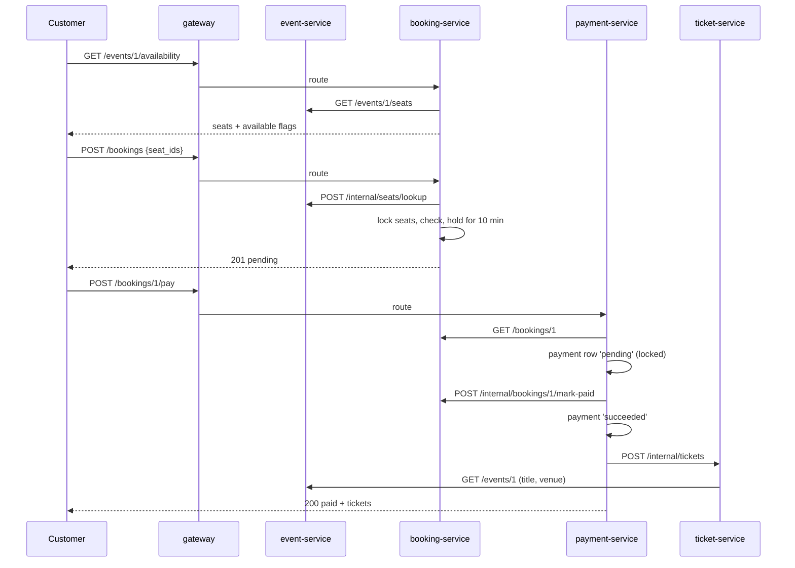
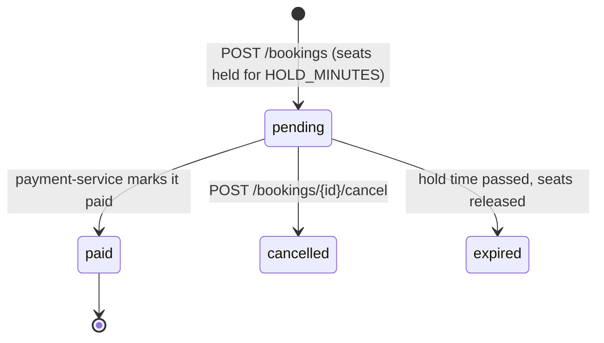

# Architecture

## Overview: 4 microservices behind an API gateway



Solid arrows: requests from outside, routed by the gateway. Dotted arrows: service-to-service HTTP
calls on the internal `backend` network. There are no cycles: event-service calls nobody.

| Service | Owns (its own database) | Public API (through the gateway) | Calls |
| ------- | ----------------------- | -------------------------------- | ----- |
| **event-service** | `events`, `seats` (catalog: labels, prices) | `/api/v1/events`, `/api/v1/events/{id}`, `/api/v1/events/{id}/seats` | — |
| **booking-service** | `bookings`, `booking_seats` (holds, expiry) | `/api/v1/bookings…`, `/api/v1/events/{id}/availability` | event-service |
| **payment-service** | `payments` | `/api/v1/bookings/{id}/pay`, `/api/v1/payments/{booking_id}` | booking-service, ticket-service |
| **ticket-service** | `tickets` (one per seat, ever) | `/api/v1/tickets/{code}`, `/api/v1/tickets?booking_id=` | event-service |

Internal endpoints (`/internal/...`) exist only for service-to-service calls. The gateway does not
route them, so they cannot be called from outside (checked by the smoke test).

## Containers

| Container | Image | Networks | Published port |
| --------- | ----- | -------- | -------------- |
| `gateway` | `nginx:1.27-alpine` | frontend, backend | 80 |
| `event-service` | `services/event-service/Dockerfile` | backend, event-data | — |
| `booking-service` | `services/booking-service/Dockerfile` | backend, booking-data | — |
| `payment-service` | `services/payment-service/Dockerfile` | backend, payment-data | — |
| `ticket-service` | `services/ticket-service/Dockerfile` | backend, ticket-data | — |
| `event-db`, `booking-db`, `payment-db`, `ticket-db` | `postgres:16-alpine`, own volume each | its own `*-data` network | — |
| `cadvisor` | `gcr.io/cadvisor/cadvisor` | frontend | 8080 |
| `tests-*` (profile `test`) | the `test` stage of each service's Dockerfile | that service's `*-data` | — |

### Networks (isolation)

- `frontend`: only the gateway and cAdvisor.
- `backend` (`internal: true`): gateway ↔ services, and services ↔ each other.
- `event-data`, `booking-data`, `payment-data`, `ticket-data` (`internal: true`): each connects
  **one** service to **its own** database. event-service cannot even resolve `booking-db`.

### Code layout

```
services/
  common/              tiny shared library: DB helpers, JSON errors, /health, HTTP client
  event-service/       event_service/ (routes, service.py, schema.sql), tests/, Dockerfile, requirements.txt
  booking-service/     booking_service/ (+ clients.py: calls to other services), tests/, ...
  payment-service/     ...
  ticket-service/      ...
```

`common` holds no business rules: each service's data and rules live only in that service.

## Data per service


*event-db*


*booking-db* (`seat_id`, `event_id` refer to event-service data: plain numbers, not foreign keys;
the seat label and price are copied in at booking time)

`payment-db`: `payments` (UNIQUE `booking_id`) · `ticket-db`: `tickets` (UNIQUE `seat_id`, UNIQUE
`code`, event details copied in so a ticket stays valid even if event-service is down).

## A booking, step by step



## Booking lifecycle



## How double booking is prevented

1. booking-service takes a Postgres **advisory lock per seat** (`pg_advisory_xact_lock(7, seat_id)`,
   in seat-id order so it can't deadlock) before checking whether the seat is free. Two customers
   clicking the same seat at the same moment are handled one after the other, even with several
   booking-service replicas, because the lock lives in booking-db.
2. ticket-service has `UNIQUE (seat_id)`: even a bug elsewhere cannot issue two tickets for a seat.
3. Tested by `test_concurrent_bookings_only_one_wins`: 20 parallel requests → exactly 1 success.

## Paying across 3 services without a shared transaction

There is no single database transaction across services, so every step is **idempotent** (safe to
repeat) and the payment row records progress (`pending` → `succeeded` / `failed`):

| If this fails… | What happens | Then |
| -------------- | ------------ | ---- |
| booking-service is down | payment transaction rolls back, 503 | client retries `/pay` |
| the hold expired meanwhile | payment saved as `failed`, 409 | customer books again |
| ticket-service is down after payment | payment stays `succeeded`, 503 | retrying `/pay` only issues the missing tickets: no second charge |

All three cases are covered by tests in `services/payment-service/tests/`.

## Startup order, health and failure isolation

Each `*-db` (healthy: `pg_isready`) → its service (healthy: `/health` runs `SELECT 1` on **its own**
DB) → gateway (waits for all 4 services). Services do not wait for each other at startup: a call to a
service that is down returns a clean `503 "<service> unavailable"` (2 s connect / 5 s read timeout).
This is checked by `make resilience`: with booking-db stopped, events and tickets still work.

Every request gets an `X-Request-ID` at the gateway, and each service passes it on, so one booking
can be followed through the logs of all services.

## Dashboard

<http://localhost> is a static page (`web/`) served by the gateway itself, with no extra service.
Every 5 seconds it calls `/api/v1/stats/<service>` and `/health/<service>` for all 4 services
through the gateway, then shows:

- key numbers: revenue, tickets sold, seats on hold, bookings, events
- bookings by status, payment methods, top events by tickets
- the architecture with live state: a service or database box turns red when it is down, and each
  service box shows which container (replica) answered and how long it took

Each service reports only its own numbers, so when one is down only its numbers disappear and the
rest of the page keeps working (the same fault isolation as the API).
