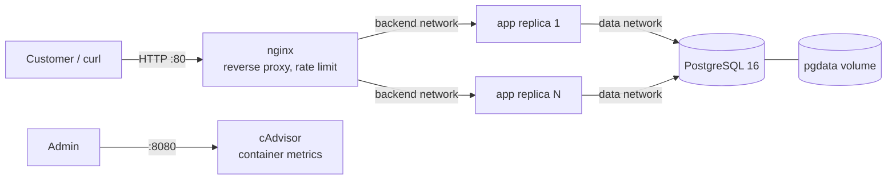
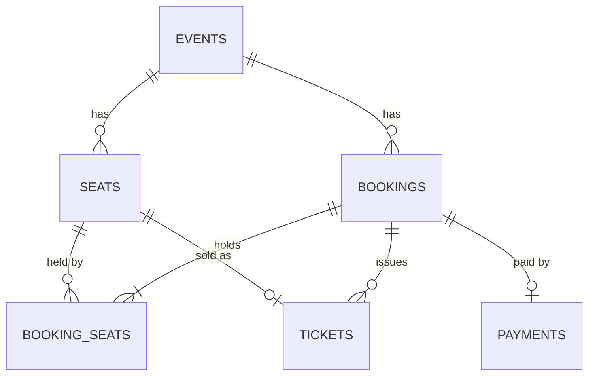
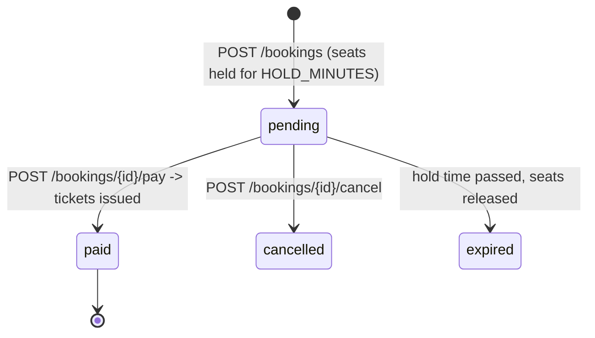

# Architecture

## Overview

| Container  | Image                       | Networks           | Published port | Purpose |
| ---------- | --------------------------- | ------------------ | -------------- | ------- |
| `nginx`    | `nginx:1.27-alpine`         | frontend, backend  | 80             | Single entry point, load balancing, rate limiting, `X-Request-ID` |
| `app`      | built from `app/Dockerfile` | backend, data      | — (only 5000 inside) | Flask + Gunicorn REST API, can run N replicas |
| `db`       | `postgres:16-alpine`        | data               | —              | All data, stored in the `pgdata` named volume |
| `cadvisor` | `gcr.io/cadvisor/cadvisor`  | frontend           | 8080           | CPU / memory / network / disk per container |
| `tests`    | `app/Dockerfile` (test stage) | data             | —              | Only with `--profile test`: ruff + pytest on a separate `ticketing_test` DB |

### Networks (isolation)

- `frontend` — normal bridge network. Only nginx and cAdvisor are here.
- `backend` — `internal: true`. nginx ↔ app. No internet, not reachable from the host.
- `data` — `internal: true`. app ↔ db. nginx cannot even see the database.

## Domain model

## Booking lifecycle

## How double booking is prevented

1. `POST /bookings` locks the requested seat rows with `SELECT ... FOR UPDATE`. If two customers
   click the same seat at the same moment, the second request waits for the first transaction,
   then sees the seat as taken and gets `409 Conflict`.
2. `tickets.seat_id` is `UNIQUE` in the database: even a bug in the code cannot sell one seat twice.
3. Tested by `test_concurrent_bookings_only_one_wins`: 20 parallel requests → exactly 1 success.

## Startup order and health

`db` (healthy: `pg_isready`) → `app` (healthy: `/health` runs `SELECT 1`) → `nginx` (healthy:
`/nginx-health`). `depends_on: condition: service_healthy` makes each service wait for the previous
one to be **ready**, not just started. The app also retries the DB connection on startup and creates
its schema under a Postgres advisory lock, so several replicas can start at the same time safely.
